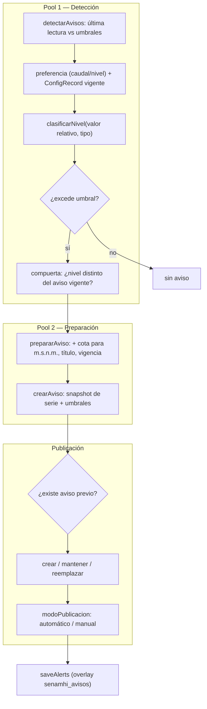
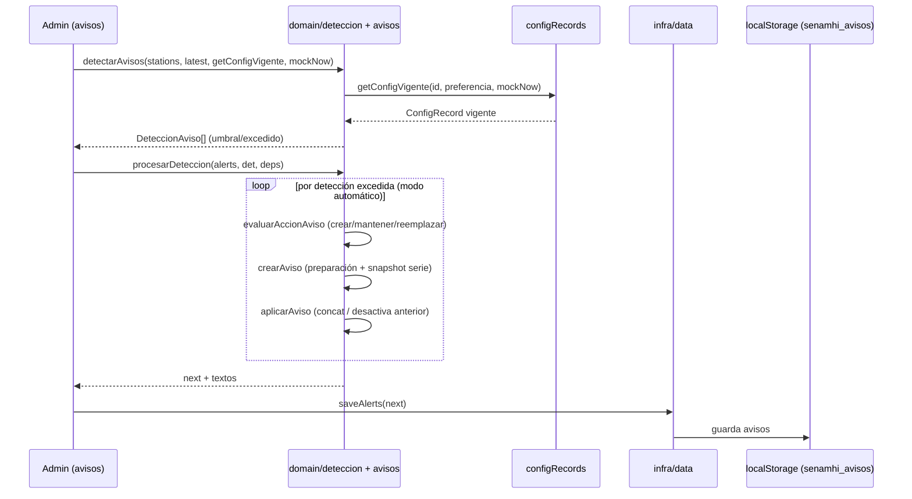

# 05 — Flujo del módulo Avisos

Avisos hidrológicos preventivos. El flujo replica dos "pools" del proceso Bizagi.

## 1. Diagrama de flujo (BPMN simplificado)

## 2. Diagrama de secuencia

## 3. Reglas de negocio

1. **Pool 1 (detección)** compara el valor **relativo** contra umbrales **relativos** (sin cota). Usa `Station.preferencia` y `getConfigVigente`.
2. **`clasificarNivel`**: avenida = mayor es peor; vaciante = menor es peor.
3. **Compuertas** (`evaluarAccionAviso`):
   - sin aviso previo → `crear`.
   - con previo y mismo nivel → `mantener` (no hace nada).
   - con previo y distinto nivel → `reemplazar` (desactiva el anterior + crea).
4. **Pool 2 (preparación)**: si es nivel y hay cota, `nivel absoluto = nivel relativo + cota` (solo visualización); si no hay cota, el nivel se muestra y guarda (`Alert.nivelActual`) como relativo en **m**. Regla única en `lib/domain/unidades.ts`. La vigencia sale de `Umbral.vigenciaHrs` del umbral excedido (avenida y vaciante se evalúan a la vez; solo cuentan los umbrales cuyo periodo cubre la fecha).
5. **Publicación** (`procesarDeteccion`, compuerta "¿publicación automática?"):
   - `modoPublicacion === "automatico"` → publica (`aplicarAviso`).
   - `"manual"` → `dejarPendiente`: el aviso se lista con `estado: "pendiente"` y `vigente: false`. No es público (`loadAlertsPublicados`) ni cuenta como aviso previo. Si sube o cambia de nivel antes de aprobarse, el pendiente se actualiza conservando su número.
   - `aprobarAviso` lo publica (`validadoDZ: true`) y **recién entonces** desactiva el aviso vigente anterior, para que la estación nunca quede sin aviso público. `descartarAviso` lo marca `"descartado"`.
   - Un pendiente que deja de corresponder (ya no supera umbral, el vigente ya cubre ese nivel o la estación pasó a automática) se descarta en la siguiente detección.
6. **Vigencia** (derivada al leer): `Alert.vence` = emisión + `duracionHoras` (hora exacta; sin `vence`, fin del día `fin`). `getAlerts`/`loadAlerts` aplican `aplicarVencimiento(alerts, getMockNow())`, así un aviso vencido deja de ser vigente en todas las vistas y **no cuenta como aviso previo**: si el río sigue sobre el umbral, la siguiente detección crea uno nuevo.
7. **Disparo (job horario simulado)**: `lib/infra/deteccionHoraria.ts`. La primera lectura de avisos de cada hora de datos (`getMockNow()`) ejecuta detección + publicación y guarda la hora procesada (`senamhi_deteccion_hora`). Las vistas leen con `avisosActualizados()` / `avisosPublicadosActualizados()` en vez de `loadAlerts`. El botón "Forzar detección ahora" del admin la reejecuta (tras cambiar umbrales o modo); "Limpiar avisos creados" reinicia la hora procesada.
8. **Vuelta a la normalidad**: el aviso **no se cierra solo**; sigue publicado hasta vencer (evita abrir y cerrar avisos si el caudal oscila en el umbral). El admin y el panel lo marcan "río normalizado" para que el operador decida si lo deshabilita antes.
9. **Aviso congelado**: `Alert.serie` guarda el snapshot de la serie al emitir; el detalle usa `aviso.serie ?? getSeriesMerged(...)`.

## 4. Puntos de entrada / componentes

| Archivo | Rol |
| --- | --- |
| `lib/domain/deteccion.ts` | `detectarAvisos` (Pool 1). |
| `lib/domain/umbrales.ts` | `clasificarNivel`. |
| `lib/domain/avisos.ts` | `evaluarAccionAviso`, `prepararAviso`, `crearAviso`, `aplicarAviso`, `dejarPendiente`, `aprobarAviso`, `descartarAviso`, `procesarDeteccion`. |
| `lib/domain/nivelesPeligro.ts` | Peligro/recomendación por nivel y tipo. |
| `app/admin/avisos/page.tsx` | Detección, publicación manual/automática, toggle vigencia, restore. |
| `app/avisos/page.tsx` | Listado público de avisos. |
| `app/avisos/[id]/page.tsx` | Detalle del aviso (con hidrograma congelado). |

## 5. Producción

- La detección (`detectarAvisos`) y las compuertas son **dominio puro** → servicios Spring.
- La auto-publicación se dispara por un job (scheduler) o al ingerir nuevas observaciones. En el PoC ese job está simulado en `lib/infra/deteccionHoraria.ts` y es lo único que hay que reemplazar.
- `saveAlerts` → transacción que inserta/actualiza la tabla `alerts` (y desactiva el aviso previo en "reemplazar").
- `Alert.serie` → snapshot `jsonb` o referencia a la serie persistida.
